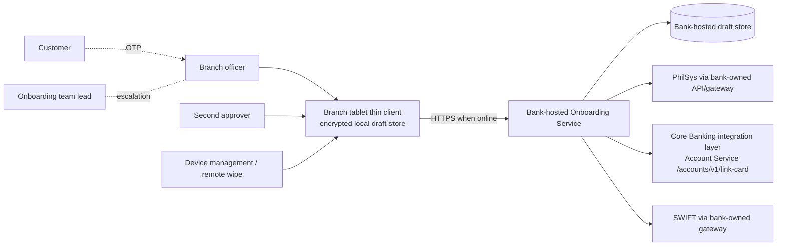
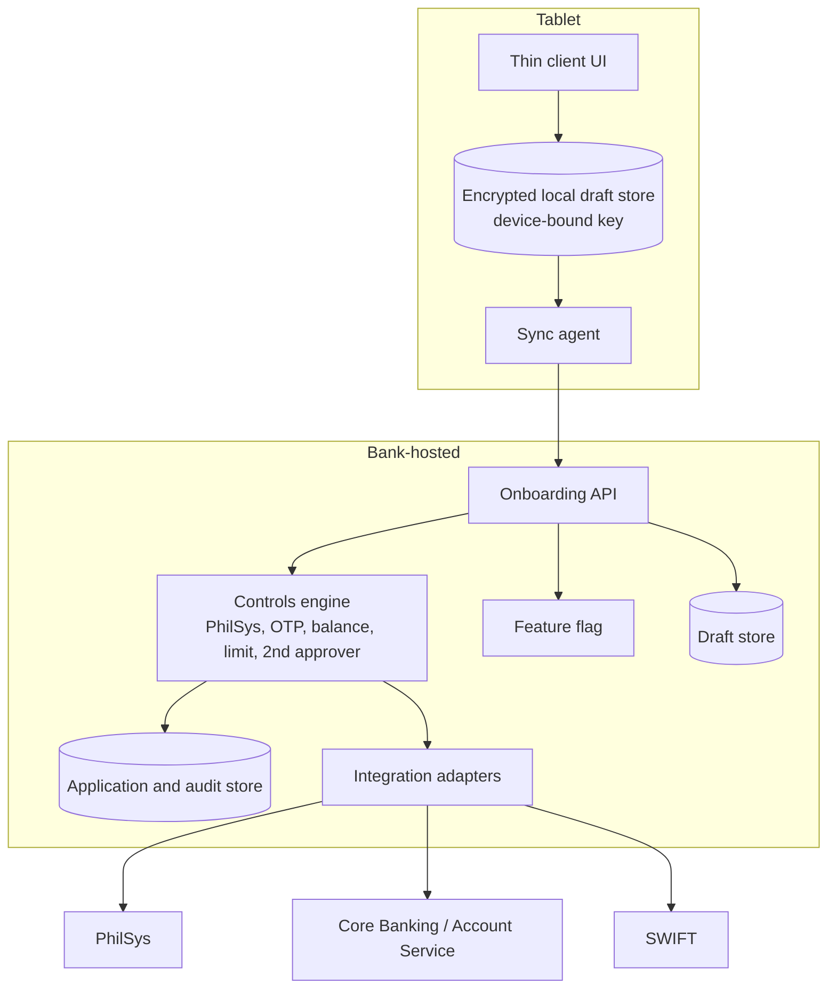

# Architecture / Solution Design

> _AI-generated via LiteLLM (architecture.md) — **unverified** until approved._

> Technology versions: no library, framework, runtime or product is named in this document. The documentation tool was not queried, so no version could be confirmed. Platform choices (tablet OS, client technology, hosting) are marked `TBD:` in section 4 (AD-09) and must be resolved, with versions confirmed against current vendor documentation, before build.

## 1. Executive Summary and Architecture Drivers

Release v2.4.1 (target 2026-11-19 [TC01_fds_retail_onboarding.md]) lets branch officers open Premium Savings accounts on a tablet and link a credit card. The design uses a **bank-hosted onboarding service** as the single orchestrator and enforcer of all controls (PhilSys outcome, OTP, second approver). The tablet is a **thin client** with an encrypted local draft store. All calls to PhilSys, Core Banking and SWIFT go through the onboarding service to existing bank-owned APIs or gateways.

| Driver | Source | Architectural consequence |
|---|---|---|
| Controls first: mandatory checks are never bypassed or deferred | Discovery (tradeoffs) | Controls are enforced server-side only. Completion is gated on recorded outcomes (AD-02). |
| Release-blocking PhilSys check (P0) | FR-003, FR-004 | The onboarding service holds the PhilSys outcome and blocks completion without it. |
| Resume after connectivity loss, up to 24 hours | FR-012, BR-013, NFR-003 | Encrypted on-device draft synced to a bank-hosted draft store (AD-03, AD-04). |
| Sensitive data on tablets (TIN, SSS, PhilSys, card numbers) | FR-001, NFR-006 | Device-bound key, purge on sync or 24-hour expiry, remote wipe (AD-05). |
| Availability 99.5% in branch hours, p95 interactive response under 3 s | Discovery (resolves NFR-005) | A single orchestrating service with no heavyweight workflow engine (section 10). |
| Phased rollout with manual fallback | Discovery (partly resolves OQ-07) | Per-branch feature flag (AD-07). |
| Measure time to open an account | FR-016, NFR-002 | Server-side per-application timestamps (section 11). |

## 2. Constraints and Assumptions

**Constraints (source-stated)**

| Constraint | Source |
|---|---|
| Release v2.4.1, target 2026-11-19 | BR-007 [TC01_fds_retail_onboarding.md] |
| Minimum opening balance PHP 125,000.00 (Premium Savings only) | BR-001, FR-002 |
| OTP valid 300 s; daily limit 50000 (unit and scope unknown) | BR-005, BR-006 |
| Second approver above PHP 125,000.00 (subject unclear) | BR-011 [TC01_tds_account_service.md] |
| `POST /accounts/v1/link-card` in the Core Banking integration layer, `accountNumber` 13 digits, error FR-1027 if already linked | FR-009 to FR-011 [TC01_tds_account_service.md] |
| Outgoing SWIFT messages use MBTCPHMM | BR-004, FR-015 |
| Same-day processing at Metro Manila branches | BR-002, FR-014, NFR-004 |
| External systems are reached only via existing bank-owned APIs or gateways; contracts agreed with owners | Discovery (integration) |
| Draft resumable up to 24 hours | Discovery |
| No data migration indicated | Discovery (migration) |

**Contradictions resolved.** The PRD marks NFR-005 (availability and response time), OQ-05 (ranking of speed versus controls) and parts of OQ-07 (rollout) as open. The approved discovery answers now give values. This document uses them: 99.5% availability in branch hours, p95 under 3 s, controls-first, and a phased feature-flagged rollout. "FR-1027" is an error code, not a PRD requirement ID. It is written as "error FR-1027" throughout.

**Assumptions**

- Assumption: the happy-path order follows FR-001 to FR-008 (OQ-02): capture, balance check, PhilSys, OTP, second approval where required, submit, link card.
- Assumption: the 24-hour draft clock starts at the last successful sync, or at draft creation if never synced. The sources do not define the start point.
- Assumption: one draft is edited on one tablet at a time, so the sync model needs no multi-device merge.
- Assumption: the bank has a device-management capability able to issue a remote wipe (not named in the sources).
- Assumption: scale is a branch-network workload of officers entering applications interactively. No volume figures are stated (`TBD:` OQ-09).
- `TBD:` account-creation contract. The sources define only link-card. The Core Banking call that creates the savings account must be agreed with its owner (OQ-06).

## 3. System Context

| Actor / system | Interaction |
|---|---|
| Branch officer | Operates the tablet. Performs the manual call-back on PhilSys failure (FR-004). |
| Second approver | Approves amounts above the threshold (FR-008). The approval channel is `TBD:` (AD-06). |
| Onboarding team lead | Receives escalations (FR-005, BR-009). |
| PhilSys, Core Banking, SWIFT | Reached only from the onboarding service. Ownership and contracts are `TBD:` (OQ-06). |

## 4. Architecture Decisions

| ID | Decision | Rationale | Alternatives considered | Consequences |
|---|---|---|---|---|
| AD-01 | A bank-hosted onboarding service orchestrates onboarding and mediates all PhilSys, Core Banking and SWIFT calls. The tablet is a thin client. | Discovery decision. A single enforcement point keeps controls out of reach of the device and keeps external credentials off tablets. | Tablet calls external systems directly (rejected: credentials and control logic on the device). | The service is on the critical path for 99.5% availability. The tablet works offline only for draft capture. |
| AD-02 | Controls-first, server-side enforcement. PhilSys outcome (FR-003, FR-004), OTP (FR-006), balance (FR-002), daily limit (FR-007) and second approver (FR-008) are enforced by the onboarding service. A completion state is unreachable unless every control has a recorded outcome. No offline path can complete or submit an application. | Discovery tradeoff: controls are never bypassed or deferred. | Client-side-only checks with later reconciliation (rejected: defers controls). Time-boxed "override" mode (rejected: bypass). | Officers cannot finish an application while offline or while PhilSys is unreachable. The application waits in draft (see R-02). Client validation is UX only. |
| AD-03 | Draft state is held encrypted on the tablet and synced to a bank-hosted draft store on reconnect. | Discovery decision. Satisfies FR-012, BR-013 and NFR-003 without requiring connectivity during data entry. | Server-only drafts (rejected: lost on connectivity loss). Plain device storage (rejected: sensitive data). | A sync protocol is needed (AD-04). The same sensitive-data controls are needed on both stores. |
| AD-04 | The draft sync is idempotent and versioned. Each draft has a client-generated draft ID and a monotonically increasing revision. The service accepts a revision only if it is newer than the stored one. A resume reopens the same draft ID (FR-012: "same application, not a new one"). | Safe retry after partial failures. Avoids duplicate applications. | Last-write-wins on timestamps (rejected: depends on device clocks). Full multi-device merge (rejected: out of scope under the single-device assumption). | Sync retry and backoff policy is `TBD:` (known gap). The default is to retry on reconnect and on officer resume. |
| AD-05 | Sensitive draft data on the tablet is protected by a device-bound encryption key. It is purged on successful sync or at 24-hour expiry, and can be remotely wiped. | Discovery decision. Covers TIN, SSS, PhilSys and card numbers (FR-001, NFR-006). | App-level password-derived key (rejected: weaker, officer burden). | Remote wipe needs connectivity, so the on-device 24-hour expiry is the offline backstop. Expiry must not rely on a tamperable clock (see R-04). |
| AD-06 | Second approver (FR-008) is verified by the onboarding service. The approver must be a distinct authenticated identity from the originating officer. The threshold, the daily limit and the OTP validity are configuration values held by the service, not hard-coded. | BR-011 is garbled (OQ-04) and BR-006's unit and scope are unknown (OQ-03). Configuration lets the owners resolve these without redesign. | Hard-coded rules (rejected: open questions). | `TBD:` where the approver authenticates (same tablet or separate channel) and which amounts the rule covers. Initial values: 125,000.00, 50000 and 300 s. |
| AD-07 | A per-branch feature flag controls access to tablet onboarding. The manual process remains the fallback. | Discovery decision. A phased rollout reduces risk for the 2026-11-19 date. | Big-bang rollout (rejected). | The flag is evaluated by the onboarding service. Branch phasing order and training are `TBD:` (OQ-07). |
| AD-08 | Integration adapters inside the onboarding service isolate each external contract (PhilSys, Core Banking, SWIFT). Each is configured with timeouts and returns normalized outcomes. | Contracts are agreed with owners and may change independently. | Direct calls from the orchestration logic (rejected: coupling). | Adapters need contract tests (section 12). |
| AD-09 | Platform choices are deferred: tablet OS, client technology, service runtime, hosting and draft-store technology are not selected. | Not stated in sources (known gap). No version could be confirmed, so none is named. | None evaluated. | `TBD:` a platform decision record is required before build. It must resolve versions through current vendor documentation. |

## 5. Component Design and Responsibilities

| Component | Responsibilities | Requirements |
|---|---|---|
| Thin client UI | Captures fields. Shows control outcomes and understandable errors. Shows the escalation contact. Does no authoritative validation. | FR-001, FR-005, FR-011 |
| Encrypted local draft store | Auto-saves each change. Holds a draft for at most 24 hours. Purges on successful sync or at expiry. | FR-012, NFR-003 |
| Sync agent | Pushes draft revisions on reconnect. Pulls state for resume. Purges the local copy after server acknowledgement. | FR-012, BR-013 |
| Onboarding API | Authenticates officers. Checks the feature flag. Exposes draft, control and submit operations. | FR-013, AD-07 |
| Controls engine | Enforces and records PhilSys outcome, call-back outcome, OTP (300 s), minimum balance, daily limit, and second approver. Gates completion (AD-02). | FR-002 to FR-008 |
| Integration adapters | PhilSys check, account creation (`TBD:`), link-card call, SWIFT messages. | FR-003, FR-009 to FR-011, FR-015 |
| Draft store (bank-hosted) | Persists synced drafts by draft ID and revision. | FR-012 |
| Application and audit store | Persists applications with branch code, control outcomes and timestamps. | FR-013, FR-016 |
| Device management | Issues the remote wipe. Owner and tooling are `TBD:`. | AD-05 |

**Configuration held by the service**

| Item | Value | Source |
|---|---|---|
| Minimum balance, Premium Savings | PHP 125,000.00 | BR-001 |
| Second-approver threshold | PHP 125,000.00 (subject `TBD:`) | BR-011 |
| OTP validity | 300 s | BR-005 |
| Daily limit | 50000 (unit and scope `TBD:`) | BR-006 |
| SWIFT bank identifier | MBTCPHMM | BR-004 |
| Call-back contact for PhilSys failure | [PII_PHONE_e19d301dfddb8f98e8472ed6e9a0e1f1] | BR-008 [TC01_fds_retail_onboarding.md] |
| Escalation contact (team lead) | [PII_PERSON_bf5612b2489414c346daab8ab68da4ba], [PII_EMAIL_24d975a01099114cf9861e108b2775c6] | BR-009 [TC01_fds_retail_onboarding.md] |

## 6. Data Architecture

**Entities**

| Entity | Content | Location | Lifetime |
|---|---|---|---|
| Draft | Captured fields (customer name, mobile, additional contacts, email, TIN, SSS, PhilSys number, account, card, home address), draft ID, revision, branch code, start timestamp | Tablet (encrypted), then draft store | Tablet: purged on sync or at 24 h. Server retention `TBD:` |
| Application | Submitted application, branch code (BR-003), status, start and completion timestamps (FR-016) | Application store | `TBD:` (OQ-10) |
| Control outcome | PhilSys pass or fail, call-back outcome, OTP verification result, second-approver identity and time, limit check | Application and audit store | `TBD:` |
| Link-card result | Success or error FR-1027 | Application store | `TBD:` |

**Data flow.** The officer enters data on the tablet and it is saved locally, encrypted. When online, the sync agent pushes revisions to the draft store. The online steps run through the onboarding service: PhilSys check, OTP, approval and submission. On successful sync the local copy is purged. On resume the officer opens the same draft ID, from the tablet if unexpired or from the draft store.

**Protection.** Sensitive fields (TIN, SSS, PhilSys, account and card numbers) are encrypted at rest on the device with a device-bound key (AD-05). Assumption: the draft store and application store also encrypt at rest and restrict access by role. Server-side retention, access rules and applicable regulation are `TBD:` (OQ-10, NFR-006). Card-number handling standards are `TBD:`; the sources do not state whether card-data standards apply.

**Data migration.** None is indicated. The manual process is not migrated, and applications opened manually stay manual.

## 7. API, Event, and Integration Contracts

**Link-card (defined)** [TC01_tds_account_service.md]

| Item | Contract |
|---|---|
| Endpoint | `POST /accounts/v1/link-card` in the Core Banking integration layer (service versioned v2.4.1) |
| Request | `accountNumber`, `cardNumber`, `holderName`, `holderTin`, `holderEmail`, `mailingAddress` |
| Validation | `accountNumber` is 13 digits (FR-010, BR-010) |
| Error | Code FR-1027 if the card is already linked (FR-011, BR-012). The adapter maps it to a user-facing message (text `TBD:`). |
| Caller | Only the onboarding service adapter, never the tablet |

**Contracts to be agreed with owners (OQ-06)**

| Interface | Needed from the owner | Status |
|---|---|---|
| PhilSys check | Request and response shape, pass and fail semantics, behavior when unavailable, latency | `TBD:` |
| Account creation (Core Banking) | Create savings account with opening balance | `TBD:` (not in sources) |
| SWIFT | Trigger and message type within onboarding, with MBTCPHMM (FR-015) | `TBD:` |
| Device management | Remote wipe command and acknowledgement | `TBD:` |

**Onboarding service API (internal, outline).** Only the resource shapes are fixed here. Paths, schemas and authentication are `TBD:`.

| Operation | Purpose | Requirements |
|---|---|---|
| Sync draft (create or update by draft ID and revision) | Idempotent draft upload | FR-012 |
| Get draft | Resume the same application | FR-012 |
| Run PhilSys check | Returns and records the outcome | FR-003 |
| Record call-back outcome | Required after PhilSys failure | FR-004 |
| Issue and verify OTP | 300 s validity | FR-006 |
| Record second approval | Distinct approver identity | FR-008 |
| Submit application | Fails unless all control outcomes are recorded | FR-002, FR-007, FR-013 |
| Link card | Calls link-card, surfaces error FR-1027 | FR-009 to FR-011 |

Errors from the service use stable codes that wrap downstream errors, preserving error FR-1027 as a distinguishable condition.

## 8. Deployment Topology and Environments

Sources state no hosting, region or environment topology (known gap). The design constraints are:

- **Tablet tier:** branch tablets running the thin client, managed by the device-management capability (Assumption).
- **Service tier:** the onboarding service, draft store and application and audit store are bank-hosted, with network paths to the PhilSys, Core Banking and SWIFT gateways.
- **Environments:** `TBD:` at minimum a test environment with stubs or sandboxes of the three external systems, and production. Names and counts are not stated.
- **Redundancy:** a single logical service is deployed in a way that meets 99.5% in branch hours (section 10). Hosting platform, node counts and network design are `TBD:` (AD-09).

## 9. Security, Privacy, and Threat Considerations

Applicable regulations are not stated (NFR-006, OQ-10). The controls below are source-stated (OTP, second approver, device-bound key, purge, remote wipe) or Assumptions.

| Threat | Mitigation | Requirement |
|---|---|---|
| Lost or stolen tablet exposes drafts | Device-bound key, 24-hour purge, remote wipe | AD-05, NFR-006 |
| Control bypass by a modified client | All controls enforced server-side, with a completion gate | AD-02, FR-003 to FR-008 |
| Single person approving a high-value application | Second approver must differ from the originating officer (AD-06) | FR-008 |
| OTP replay or late use | Server-side validation, 300 s validity, single use (Assumption) | FR-006, NFR-001 |
| Device clock tampering extends draft life | Expiry is checked against the last trusted server time plus a monotonic elapsed measure. The service also rejects drafts older than 24 h (Assumption). | AD-05 |
| Sensitive data in logs and metrics | No identifier or card values in logs. Use draft ID and application ID only (Assumption). | NFR-006 |
| External credentials on devices | Credentials held only by the onboarding service adapters | AD-01 |
| Unauthorized draft access | Role-based access and encryption at rest on server stores (Assumption). Authentication method `TBD:`. | NFR-006 |

## 10. Scalability, Reliability, and Performance

| Target | Value | Source |
|---|---|---|
| Availability, online onboarding path (PhilSys check, submission, card linking) | 99.5% during branch hours (hours definition `TBD:`) | Discovery (resolves NFR-005) |
| Interactive response | p95 under 3 s | Discovery (resolves NFR-005) |
| Draft resumability | Up to 24 h | Discovery, NFR-003 |
| Same-day processing, Metro Manila | 100% | NFR-004, BR-002 |
| Volume and concurrency | `TBD:` not stated | OQ-09 |

- **Simplicity:** one stateless orchestrating service with horizontally replicable instances (Assumption) and no distributed workflow engine. State lives in the draft store and application store.
- **Interactive latency:** the 3 s p95 depends on the PhilSys and Core Banking response times. Adapters use bounded timeouts. The latency budget per external call is `TBD:` and is to be set with the owners (OQ-06).
- **Downstream unavailability:** controls are not skipped (AD-02). On PhilSys or Core Banking failure, the application stays in a resumable draft and the officer retries. Whether the call-back fallback applies to PhilSys unavailability, as distinct from a failed check, is `TBD:` (see R-02). The manual process remains the branch-level fallback.
- **Connectivity loss:** auto-save is local and immediate. Sync resumes on reconnect (AD-04). Beyond 24 hours the draft is purged and the officer restarts or uses the manual process.
- **Same-day processing:** submitted applications are tracked with a processing status. Applications still pending toward the end of the business day at Metro Manila branches raise an alert (NFR-004).
- **Backup and disaster recovery:** `TBD:` not stated. This is a known gap.

## 11. Observability and Operations

Source-backed metrics (PRD section 11):

| Metric | Derived from | Requirement |
|---|---|---|
| Time to open an account, per application | Start and completion timestamps recorded server-side | FR-016, M-01, NFR-002 |
| Share of applications with a recorded PhilSys outcome (pass, or fail with call-back outcome) | Control outcome records | FR-003, FR-004, M-02 |
| Drafts auto-saved and resumed | Sync and resume events | FR-012, M-03 |
| Count of error FR-1027 | Link-card adapter | FR-011, M-04 |

Additions (Assumption): availability and p95 latency per onboarding operation (against NFR-005), sync success and failure counts, applications pending past the same-day cut-off (NFR-004), OTP and approval failure counts, and counts of drafts expired or wiped.

- **Audit trail:** every control outcome is stored with actor, branch code and time (supports FR-003 to FR-008).
- **Alerting, dashboards, logging standards:** `TBD:` not stated.
- **Production support:** incidents are reported to the service desk on [PII_PHONE_ade65b7c5c39028ec4ebe53cc4d57070] [TC01_tds_account_service.md].
- **Rollout monitoring:** compare metrics for flag-enabled branches against the pre-release baseline. The baseline method is `TBD:` (OQ-01).

## 12. Testing Strategy

| Level | Focus | Requirements |
|---|---|---|
| Unit | Control rules: minimum balance, OTP at 300 s boundary, daily limit, threshold, second-approver distinctness, 13-digit account number | FR-002, FR-006 to FR-008, FR-010 |
| Gate tests | Completion unreachable without a PhilSys outcome and call-back outcome after failure. No offline or direct-client path completes. | FR-003, FR-004, AD-02 |
| Contract | Adapter tests against agreed contracts or stubs for PhilSys, Core Banking (including error FR-1027) and SWIFT identifier MBTCPHMM | FR-009 to FR-011, FR-015 |
| Resilience | Connectivity cut at each step. Verify no fields lost and the same draft ID on resume. Test sync retry, duplicate delivery, and 24-hour expiry purge. | FR-012, NFR-003 |
| Security | Device-bound key, purge on sync and on expiry, remote wipe, and no sensitive values in logs | AD-05, NFR-006 |
| Performance | p95 under 3 s on the online path at expected branch load (volume `TBD:`) | NFR-005 |
| Same-day | Submitted applications at Metro Manila branches processed by end of day | FR-014, NFR-004 |
| Measurement | Timestamps present for every application | FR-016, NFR-002 |
| Pilot | Feature-flag pilot branches with manual fallback verified | AD-07 |

Field formats, mandatory flags and message texts are `TBD:` (OQ-08), so those test cases are pending.

## 13. Delivery, Migration, and Rollback Strategy

- **Rollout:** phased by branch behind the per-branch flag (AD-07), starting with pilot branches. The sequence, number of phases and training are `TBD:` (OQ-07). Release target is 2026-11-19 (BR-007).
- **Coexistence:** the manual process stays available in every branch throughout. A tablet application and a manual application are separate cases.
- **Prerequisites before enabling a branch:** the external contracts agreed (OQ-06), the pre-release baseline captured (OQ-01), device-management remote wipe verified, and PhilSys-failure call-back contacts configured.
- **Rollback:** disable the flag for a branch to stop new tablet applications. Officers use the manual process. In-flight drafts are either completed through the service while it is still available or abandoned. Local copies purge at 24 hours at the latest. The behavior of in-flight drafts on rollback is `TBD:`.
- **Data migration:** none. Rollback involves no data restoration beyond the draft and application stores.

## 14. Risks and Technical Debt

| ID | Risk | Mitigation / owner action |
|---|---|---|
| R-01 | Connectivity loss mid-application (PRD R-01) | AD-03 and AD-04; tests for NFR-003 |
| R-02 | PhilSys check failure or unavailability blocks onboarding (PRD R-02). Controls-first means no bypass. | FR-004 call-back and FR-005 escalation. `TBD:` whether the call-back fallback also applies to PhilSys unavailability. The manual process remains available. |
| R-03 | Success target undefined (PRD R-03) | Settle the target and baseline method (OQ-01) |
| R-04 | Remote wipe cannot reach an offline tablet; device clock tampering undermines expiry | Local 24-hour expiry with server-time checks (AD-05, section 9) |
| R-05 | Ambiguous BR-006 and BR-011 (PRD R-04) | Rules held as configuration (AD-06). Resolve OQ-03 and OQ-04 before build. |
| R-06 | Unknown regulations and server retention (PRD R-05) | Resolve OQ-10 with compliance. Retention is `TBD:`. |
| R-07 | Unagreed external contracts, including account creation, which is not in the sources | Agree with owners (OQ-06). Adapters (AD-08) limit the blast radius. |
| R-08 | Platform undecided (AD-09), with no sync-retry, backup or disaster recovery design | Platform decision record before build. Define the sync-retry policy and DR targets. |
| R-09 | Rollout and training unplanned for 2026-11-19 (PRD R-06) | Define the rollout plan (OQ-07) |

**Deliberate technical debt:** no multi-device draft merge (single-device assumption). No workflow engine. Server-side retention and DR deferred until the owners provide targets.

## 15. Requirement-to-Component Traceability

| Requirement | Component(s) | Decision / section |
|---|---|---|
| FR-001 | Thin client UI, local draft store, draft store | AD-03, section 6 |
| FR-002 | Controls engine | AD-02, section 5 |
| FR-003 | Controls engine, PhilSys adapter | AD-02, AD-08 |
| FR-004 | Controls engine, thin client UI | AD-02, section 5 |
| FR-005 | Thin client UI, configuration (escalation contact) | Section 5 |
| FR-006 | Controls engine | AD-02, AD-06 |
| FR-007 | Controls engine | AD-02, AD-06 |
| FR-008 | Controls engine | AD-06 |
| FR-009 | Core Banking adapter | Section 7, AD-08 |
| FR-010 | Core Banking adapter, Controls engine | Section 7 |
| FR-011 | Core Banking adapter, thin client UI | Section 7 |
| FR-012 | Local draft store, sync agent, draft store | AD-03, AD-04 |
| FR-013 | Onboarding API, application store | Section 6 |
| FR-014 | Application store, alerting | Section 10 |
| FR-015 | SWIFT adapter | Section 7, AD-08 |
| FR-016 | Application and audit store | Section 11 |
| NFR-001 | Controls engine | AD-06 |
| NFR-002 | Application and audit store, metrics | Section 11 |
| NFR-003 | Local draft store, sync agent | AD-03, AD-04, section 12 |
| NFR-004 | Application store, alerting | Section 10 |
| NFR-005 | Onboarding service, adapters | Section 10 (99.5% branch hours, p95 under 3 s) |
| NFR-006 | Device key, purge, wipe, server stores | AD-05, section 9 (regulations `TBD:`) |
