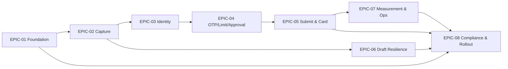

# Epics & User Stories Backlog

> _AI-generated via LiteLLM (backlog.md) — **unverified** until approved._

> Inputs: approved PRD (FR-001 to FR-016, NFR-001 to NFR-006, BR-001 to BR-014) and approved Architecture (AD-01 to AD-09), the FDS [TC01_fds_retail_onboarding.md], the TDS [TC01_tds_account_service.md] and approved discovery answers. Facts from discovery carry no label. `Assumption:` marks model-introduced content. `TBD:` marks a gap that needs an owner decision.

## 1. Planning Assumptions

**Release context.** The release is v2.4.1, target 2026-11-19 (BR-007) [TC01_fds_retail_onboarding.md]. The first usable increment is a thin end-to-end slice delivered to a pilot branch behind the per-branch feature flag. The slice runs capture, balance check, PhilSys check with call-back, OTP and submit, with server-side gating.

**Confirmed happy-path order** (discovery; resolves OQ-02): capture, balance check, PhilSys, OTP, second approval if required, submit, then link card.

**Planning assumptions**
- Assumption: 2-week sprints, and a placeholder capacity of about 20 story points per sprint. No team velocity or calendar is supplied. Story points are relative (1, 2, 3, 5, 8). Mapping sprints to calendar dates is `TBD:`.
- Dependencies are built against stubs of agreed-in-draft contracts. Owner sandboxes are swapped in later through the integration adapters (AD-08). Stubs in CI plus a bank test environment validate stories. Owner sandbox verification gates enabling the first pilot branch.
- Acceptance criteria use configurable placeholder values, such as `<FIELD_FORMAT>`, `<MESSAGE_TEXT>` and `<DAILY_LIMIT_SCOPE>`. Each TBD item is a pre-sprint decision with a named owner, listed below.
- Owners are not named in any source, so each owner field reads `TBD: name to be assigned`.
- A compliance decision spike (US-031) gates pilot enablement. Server-side retention is configurable (US-033). Baseline controls (US-032, US-005, US-024, US-025) are built in the meantime.
- No library, framework or runtime version is stated in any supplied source, so none is named in this backlog. The only version in the sources is the Account Service version v2.4.1 [TC01_tds_account_service.md]. Platform choices are deferred to US-001 (AD-09).

**Contradictions and resolutions (newest approved upstream artifact wins)**
- The PRD leaves NFR-005 and OQ-05 open. The Architecture sets 99.5% availability in branch hours, p95 interactive response under 3 s, and controls-first. This backlog uses the Architecture values.
- The PRD journey assumed the happy-path order (OQ-02). Discovery now confirms it, so it is no longer an assumption.
- "FR-1027" is the TDS error code for an already-linked card, not a PRD requirement ID [TC01_tds_account_service.md]. It is written as "error FR-1027".
- The PRD rates OTP (FR-006) as P1. The discovery-defined pilot slice includes OTP, so US-013 is P0 for pilot purposes only. The requirement priority is unchanged.
- The second-approver rule (BR-011) and the 50000 daily limit (BR-006) remain ambiguous. They are handled only by configurable placeholders and pre-sprint decisions.

**Pre-sprint decision register** (each blocks the stories listed until resolved or placeholders are accepted)

| ID | Decision needed | Source gap | Blocks | Owner |
|---|---|---|---|---|
| PD-01 | Field formats, mandatory flags, error message texts | OQ-08 | US-006, US-008, US-018, US-019 | TBD: name to be assigned |
| PD-02 | Daily limit unit and scope | OQ-03, BR-006 | US-014 | TBD: name to be assigned |
| PD-03 | OTP applicability and delivery channel | OQ-03 | US-013 | TBD: name to be assigned |
| PD-04 | Second-approver rule subject, approver authentication channel, account-number display pattern | OQ-04, BR-011 | US-015, US-006 | TBD: name to be assigned |
| PD-05 | PhilSys contract, owner, behavior when unavailable, latency budget. Whether the call-back fallback also applies to unavailability. | OQ-06, R-02 | US-009, US-012, US-035 | TBD: name to be assigned |
| PD-06 | Core Banking account-creation contract, which is not in the sources | OQ-06 | US-016, US-035 | TBD: name to be assigned |
| PD-07 | SWIFT trigger and message type within onboarding | OQ-06 | US-020 | TBD: name to be assigned |
| PD-08 | Device-management owner, tooling and remote-wipe command | AD-05 | US-025 | TBD: name to be assigned |
| PD-09 | Sync retry and backoff policy | AD-04 | US-022 | TBD: name to be assigned |
| PD-10 | Applicable regulations, server-side retention periods, backup and DR targets for TIN, SSS, PhilSys and card numbers. Card-data standard applicability. | OQ-10, NFR-006 | US-031, US-033, US-034 | TBD: name to be assigned |
| PD-11 | Baseline measurement method and reduction target % | OQ-01 | US-027 | TBD: name to be assigned |
| PD-12 | Branch phasing order, training, handling of in-flight drafts on rollback | OQ-07 | US-037, US-038 | TBD: name to be assigned |
| PD-13 | Branch-hours definition and expected volume and concurrency | OQ-09 | US-030 | TBD: name to be assigned |
| PD-14 | Platform choices (tablet OS, client technology, service runtime, hosting, draft-store technology), with versions confirmed from vendor documentation | AD-09 | US-001 | TBD: name to be assigned |

## 2. Epic Sequence and Dependency Map

| Epic | Outcome-oriented goal | Value | Depends on |
|---|---|---|---|
| EPIC-01 Pilot Foundation and Gating | Deliver a walking skeleton behind a per-branch flag, with stubbed adapters, a server-side completion gate and an audit trail, so every later story is demonstrable. | Enables the pilot slice (G-02) | None |
| EPIC-02 Application Capture and Eligibility | Officers capture a Premium Savings application and ineligible balances are rejected. | G-01 | EPIC-01 |
| EPIC-03 Identity Verification | Every application has a recorded PhilSys outcome, with a call-back path and escalation on failure. | G-02, M-02 | EPIC-01, EPIC-02 |
| EPIC-04 Customer Confirmation and Approval Controls | OTP, daily limit and second approval are enforced server-side before completion. | G-02 | EPIC-03 |
| EPIC-05 Submission and Card Linking | Officers submit the application, then link a credit card with clear errors. | G-01, G-04, M-04 | EPIC-04 (US-016 needs EPIC-03 and US-013) |
| EPIC-06 Draft Resilience and Device Data Protection | No in-progress application is lost on connectivity loss, and sensitive data on tablets is protected. | G-03, M-03 | EPIC-02 (capture), EPIC-01 |
| EPIC-07 Measurement and Operations | Time to open, control outcomes, same-day processing, availability and latency are measurable. | G-01, NFR-002, NFR-004, NFR-005 | EPIC-01, EPIC-05 |
| EPIC-08 Compliance and Rollout Readiness | Pilot enablement is gated on compliance decisions and owner-sandbox verification, with a rollback path and a rollout plan. | R-05, R-06 | EPIC-01 to EPIC-07 |

**Critical path to the pilot:** US-001, US-003, US-004, US-006, US-009, US-010, US-013, US-016, US-035, US-036. The compliance spike US-031 runs in parallel and gates enablement.

## 3. Epics and User Stories

Priority scale (from the PRD): P0 release-blocking, P1 required for v2.4.1, P2 desirable. Estimates are story points.

### EPIC-01 Pilot Foundation and Gating
**Goal:** A thin, gated, auditable skeleton runs end to end against stubs, so controls are enforced server-side from the first increment.

#### US-001 Platform decision record
As a delivery team, I want a recorded platform decision so that build can start with confirmed technology versions.
- **Priority:** P0 | **Estimate:** 2 | **Dependencies:** PD-14
- **Technical notes:** Resolves AD-09 (tablet OS, client technology, service runtime, hosting, draft-store technology). Versions must be confirmed from current vendor documentation, because no source states any. Name no version until confirmed.
- **Acceptance criteria**
  - Given AD-09 is open, when the record is approved, then every platform choice is listed with its source and a confirmed version.
  - Given an unresolved choice, when the record is reviewed, then it is marked `TBD:` and blocks only the stories that depend on it.

#### US-002 Per-branch feature flag
As a rollout manager, I want tablet onboarding enabled per branch so that a pilot branch can use it while others stay manual.
- **Priority:** P0 | **Estimate:** 3 | **Dependencies:** US-001
- **Technical notes:** AD-07. The flag is evaluated by the onboarding service, not the tablet. The manual process stays available in every branch. The branch is identified by its branch code (BR-003).
- **Acceptance criteria**
  - Given a branch with the flag off, when an officer starts an application, then the service refuses and points to the manual process.
  - Given a branch with the flag on, when an officer starts an application, then the service accepts it.
  - Given a flag change, when it is made, then an audit record is written and the change applies without a tablet release.

#### US-003 Onboarding service skeleton with adapter stubs and CI contract tests
As a developer, I want the onboarding service with adapter interfaces and stubs for PhilSys, Core Banking and SWIFT so that stories can be built and tested before owner sandboxes exist.
- **Priority:** P0 | **Estimate:** 5 | **Dependencies:** US-001
- **Technical notes:** AD-01 and AD-08. The tablet never calls external systems. Each adapter has a configurable timeout and returns normalized outcomes. Stubs follow the draft contracts, including link-card (`/accounts/v1/link-card`) [TC01_tds_account_service.md]. The PhilSys, account-creation and SWIFT contracts are drafts (PD-05, PD-06, PD-07).
- **Acceptance criteria**
  - Given the CI pipeline, when contract tests run, then each adapter passes against its stub.
  - Given a stub is replaced by an owner sandbox, when only configuration changes, then orchestration code is unchanged.
  - Given a downstream timeout, when the adapter returns, then it yields a normalized outcome with a stable error code.

#### US-004 Server-side completion gate and audit record
As a compliance officer, I want completion to be unreachable unless every control has a recorded outcome so that controls are never bypassed or deferred.
- **Priority:** P0 | **Estimate:** 5 | **Dependencies:** US-003
- **Technical notes:** AD-02. The gate lists the controls required for an application: balance, PhilSys outcome, call-back outcome after failure, OTP, and second approval when required. Each outcome is stored with actor, branch code and time (Architecture section 11). Client validation is UX only.
- **Acceptance criteria**
  - Given an application missing any required control outcome, when submit is requested, then the service rejects it with a stable error code.
  - Given a modified client or direct API call, when it tries to complete an application, then the gate still blocks it.
  - Given a control outcome is recorded, when it is stored, then the audit record contains actor, branch code and timestamp.

#### US-005 Log-safe baseline
As a security reviewer, I want no sensitive values in logs so that TIN, SSS, PhilSys and card numbers never leak through operations tooling.
- **Priority:** P0 | **Estimate:** 2 | **Dependencies:** US-003
- **Technical notes:** NFR-006. Logs identify records by draft ID and application ID only (Assumption in the Architecture). Add an automated check to the CI pipeline.
- **Acceptance criteria**
  - Given any API request containing TIN, SSS, PhilSys, account or card values, when the service logs it, then none of those values appear in logs.
  - Given an automated log-scan test in CI, when sensitive test values are injected, then the test fails if any are found.

### EPIC-02 Application Capture and Eligibility
**Goal:** Officers can capture a complete Premium Savings application and ineligible balances are rejected on the server.

#### US-006 Capture Premium Savings application
As a branch officer, I want to enter the customer record on the tablet so that a Premium Savings application can start.
- **Priority:** P0 | **Estimate:** 5 | **Dependencies:** US-002, US-004, PD-01
- **Technical notes:** FR-001 [TC01_fds_retail_onboarding.md]. Fields: customer name, mobile, additional contact and email entries, TIN, SSS number, PhilSys number, savings account, credit card and home address. Formats and mandatory flags are configurable placeholders (`<FIELD_FORMAT>`). The account-number display pattern is `TBD:` (PD-04). The thin client does UX validation only (AD-02).
- **Acceptance criteria**
  - Given an active branch, when the officer enters all listed fields, then they are stored with the application.
  - Given a field violating its configured `<FIELD_FORMAT>`, when saved, then the server returns a field-level error with `<MESSAGE_TEXT>`.
  - Given a PD-01 value is still TBD, when the story is demonstrated, then the configured placeholder is shown and the gap is logged.

#### US-007 Branch code on every application
As an operations analyst, I want each application tagged with its branch code so that it can be traced and routed.
- **Priority:** P1 | **Estimate:** 2 | **Dependencies:** US-006
- **Technical notes:** FR-013 and BR-003 (example 0457) [TC01_fds_retail_onboarding.md]. The code comes from the authenticated officer's branch. It is not entered free-form. Authentication method is `TBD:` in the Architecture.
- **Acceptance criteria**
  - Given an application is created, when it is stored, then the branch code is attached.
  - Given a client submits a different branch code than the officer's branch, when processed, then the server overrides or rejects it.

#### US-008 Minimum opening balance check
As a branch officer, I want an opening balance below the minimum rejected so that ineligible applications stop early.
- **Priority:** P0 | **Estimate:** 3 | **Dependencies:** US-006, PD-01
- **Technical notes:** FR-002 and BR-001. The minimum is PHP 125,000.00 for Premium Savings [TC01_fds_retail_onboarding.md]. It is held as service configuration (AD-06). The rejection text is a placeholder (`<MESSAGE_TEXT>`).
- **Acceptance criteria**
  - Given a balance of PHP 124,999.99, when checked, then the application is rejected with `<MESSAGE_TEXT>`.
  - Given a balance of PHP 125,000.00, when checked, then the balance control is recorded as passed.
  - Given the configured minimum is changed, when the next check runs, then the new value applies without a code change.

### EPIC-03 Identity Verification
**Goal:** Every application ends with a recorded PhilSys outcome, and failures follow a recorded call-back path.

#### US-009 PhilSys check passes
As a branch officer, I want the system to run the PhilSys check so that the customer's identity is verified.
- **Priority:** P0 | **Estimate:** 5 | **Dependencies:** US-003, US-006, PD-05
- **Technical notes:** FR-003. Executed by the onboarding service through the PhilSys adapter, built against the stub of the draft contract (AD-08). The outcome is stored with the application and audit record. The PhilSys number is never logged (US-005).
- **Acceptance criteria**
  - Given a stub that returns pass, when the check runs, then the "pass" outcome is stored and the application may proceed.
  - Given the check is requested, when it completes, then the outcome is available to the gate (US-004).
  - Given a client claims a pass, when no server record exists, then the gate still blocks.

#### US-010 PhilSys failure with call-back outcome
As a branch officer, I want to record the result of my call-back to the customer so that a failed PhilSys check can still be resolved under control.
- **Priority:** P0 | **Estimate:** 5 | **Dependencies:** US-009
- **Technical notes:** FR-004 and BR-008. The officer calls the customer on [PII_PHONE_e19d301dfddb8f98e8472ed6e9a0e1f1] [TC01_fds_retail_onboarding.md]. The contact is held as service configuration. The gating behavior is an Architecture/PRD assumption: completion is blocked without a recorded outcome. Allowed outcome values are `TBD:` and use a configurable list.
- **Acceptance criteria**
  - Given a stub that returns fail, when the check completes, then the UI shows the call-back contact and the application cannot be submitted.
  - Given a call-back outcome is recorded, when saved, then it is stored with officer, time and branch code.
  - Given no call-back outcome, when submit is requested, then the server rejects it.

#### US-011 Escalation contact for failed checks
As a branch officer, I want to see the onboarding team lead's contact so that I can escalate a failed check.
- **Priority:** P1 | **Estimate:** 2 | **Dependencies:** US-010
- **Technical notes:** FR-005 and BR-009. The team lead is [PII_PERSON_bf5612b2489414c346daab8ab68da4ba], at [PII_EMAIL_24d975a01099114cf9861e108b2775c6] [TC01_fds_retail_onboarding.md]. Held as configuration and shown by the thin client.
- **Acceptance criteria**
  - Given a failed PhilSys check, when the officer views the outcome, then the escalation contact is displayed.
  - Given the contact is changed in configuration, when the screen reloads, then the new contact appears.

#### US-012 PhilSys unavailable: safe wait, no bypass
As a branch officer, I want the application to stay in a resumable draft when PhilSys is unreachable so that no control is skipped and I can retry.
- **Priority:** P1 | **Estimate:** 3 | **Dependencies:** US-009, PD-05
- **Technical notes:** AD-02 and Architecture R-02. Whether the call-back fallback also applies to unavailability, as distinct from a failed check, is `TBD:` (PD-05). Default: no bypass, retry, and the manual process remains the branch-level fallback.
- **Acceptance criteria**
  - Given the stub returns a timeout, when the check is run, then the application stays in draft with a retryable status.
  - Given PhilSys is unavailable, when submit is requested, then it is rejected.
  - Given PhilSys returns, when the officer retries, then the check runs and its outcome is recorded.

### EPIC-04 Customer Confirmation and Approval Controls
**Goal:** OTP, the daily limit and the second approver are enforced server-side before an application completes.

#### US-013 OTP issue and verification (300 s)
As a customer, I want to confirm my application with a one-time password so that my consent is verified.
- **Priority:** P0 | **Estimate:** 5 | **Dependencies:** US-009, PD-03
- **Technical notes:** FR-006, BR-005 and NFR-001. Validity is 300 seconds [TC01_fds_retail_onboarding.md], held as configuration (AD-06). Applying OTP to customer confirmation is a PRD assumption (OQ-03). The delivery channel is `TBD:` (PD-03). Single use is an Architecture assumption.
- **Acceptance criteria**
  - Given an OTP issued 299 s ago, when verified with the correct value, then the OTP control is recorded as passed.
  - Given an OTP issued 301 s ago, when verified, then it is rejected.
  - Given an OTP already used, when verified again, then it is rejected.
  - Given the validity value is changed in configuration, when the next OTP is issued, then the new value applies.

#### US-014 Daily limit enforcement
As a bank risk owner, I want the daily limit applied server-side so that limit breaches are stopped.
- **Priority:** P1 | **Estimate:** 3 | **Dependencies:** US-004, PD-02
- **Technical notes:** FR-007 and BR-006. The value is 50000 [TC01_fds_retail_onboarding.md]. Unit and scope are TBD, so they are held as configuration (`<DAILY_LIMIT_SCOPE>`). No scope is assumed in code.
- **Acceptance criteria**
  - Given the configured limit and scope, when an amount within the limit is checked, then the limit control passes.
  - Given an amount over the configured limit, when checked, then it is rejected with `<MESSAGE_TEXT>`.
  - Given PD-02 is unresolved, when the story is demonstrated, then it runs on the placeholder scope and the gap is flagged.

#### US-015 Second approver for high-value applications
As a second approver, I want to approve amounts above the threshold so that high-value applications have dual control.
- **Priority:** P1 | **Estimate:** 5 | **Dependencies:** US-004, PD-04
- **Technical notes:** FR-008 and BR-011. The threshold is PHP 125,000.00 [TC01_tds_account_service.md], held as configuration (AD-06). The approver must be a distinct authenticated identity from the originating officer. The rule subject and approver channel (same tablet or separate) are `TBD:` (PD-04). The approval is recorded with identity and time.
- **Acceptance criteria**
  - Given an amount above the threshold, when submit is requested without an approval, then it is rejected.
  - Given an approver with the same identity as the originating officer, when approving, then the server refuses.
  - Given a distinct approver approves, when saved, then the approval is recorded with identity and time and the gate accepts it.
  - Given an amount at or below the configured threshold, when submitted, then no approval is required.

### EPIC-05 Submission and Card Linking
**Goal:** Officers submit a fully controlled application and then link a credit card, with clear errors.

#### US-016 Submit application
As a branch officer, I want to submit a fully verified application so that the savings account is created.
- **Priority:** P0 | **Estimate:** 5 | **Dependencies:** US-004, US-008, US-010, US-013, PD-06
- **Technical notes:** FR-002, FR-007 and FR-013 are enforced at submit through the gate. Account creation goes through the Core Banking adapter. The contract is not in any source (PD-06), so it is built against a stub. Until US-014 and US-015 are delivered, the gate fails closed, so any application that requires a limit check or second approval cannot be submitted. Opening-balance handling is per `TBD:` contract.
- **Acceptance criteria**
  - Given all required controls recorded, when submit is requested, then the account-creation stub is called and the application status becomes submitted.
  - Given any required control missing, when submit is requested, then the server rejects it and creates nothing.
  - Given a resubmission with the same application ID, when processed, then no duplicate account is created.
  - Given submit succeeds, when stored, then branch code and audit record are present.

#### US-017 Link credit card to the savings account
As a branch officer, I want to link a credit card after the account exists so that the customer's card is attached.
- **Priority:** P1 | **Estimate:** 5 | **Dependencies:** US-016
- **Technical notes:** FR-009 [TC01_tds_account_service.md]. The adapter calls `POST /accounts/v1/link-card` with accountNumber, cardNumber, holderName, holderTin, holderEmail and mailingAddress. Only the onboarding service calls it, never the tablet. The card number is never logged. Card-data standards are `TBD:` (PD-10).
- **Acceptance criteria**
  - Given a submitted application, when the officer requests link card, then the adapter sends the six fields and records success.
  - Given an unsubmitted application, when link card is requested, then the service rejects it.
  - Given the call is made, when logs are inspected, then no card number or TIN appears.

#### US-018 Validate 13-digit account number
As a branch officer, I want a malformed account number rejected so that bad link-card requests are caught.
- **Priority:** P1 | **Estimate:** 2 | **Dependencies:** US-017, PD-01
- **Technical notes:** FR-010 and BR-010 [TC01_tds_account_service.md]. The error text is a placeholder (`<MESSAGE_TEXT>`).
- **Acceptance criteria**
  - Given an accountNumber of 12 or 14 digits, when link card is requested, then it is rejected before any downstream call.
  - Given a 13-digit accountNumber, when requested, then validation passes.
  - Given non-digit characters, when requested, then it is rejected.

#### US-019 Already-linked card error FR-1027
As a branch officer, I want a clear message when the card is already linked so that I know why linking failed.
- **Priority:** P1 | **Estimate:** 3 | **Dependencies:** US-017, PD-01
- **Technical notes:** FR-011, BR-012 and G-04. Core Banking returns error code FR-1027 [TC01_tds_account_service.md]. The adapter maps it to a distinguishable service error code with `<MESSAGE_TEXT>`. Each occurrence is counted (US-028).
- **Acceptance criteria**
  - Given the stub returns error FR-1027, when link card is requested, then the officer sees `<MESSAGE_TEXT>` and the service error remains distinguishable as already-linked.
  - Given error FR-1027, when recorded, then the application remains submitted and the officer can continue.
  - Given error FR-1027, when counted, then the occurrence is available to metrics.

#### US-020 SWIFT bank identifier on outgoing messages
As a payments operations analyst, I want outgoing SWIFT messages to carry the bank identifier so that messages are correctly addressed.
- **Priority:** P2 | **Estimate:** 3 | **Dependencies:** US-003, PD-07
- **Technical notes:** FR-015 and BR-004. The identifier is MBTCPHMM [TC01_fds_retail_onboarding.md], held as configuration. The trigger and message type within onboarding are `TBD:` (PD-07). Build against the SWIFT stub.
- **Acceptance criteria**
  - Given the SWIFT stub receives a message, when inspected, then it carries MBTCPHMM.
  - Given the identifier is changed in configuration, when the next message is sent, then the new identifier is used.
  - Given PD-07 is unresolved, when demonstrated, then the story is limited to adapter-level identifier tests.

### EPIC-06 Draft Resilience and Device Data Protection
**Goal:** No in-progress application is lost on connectivity loss, and sensitive data on tablets is protected.

#### US-021 Encrypted local auto-save
As a branch officer, I want every change saved automatically on the tablet so that I lose nothing when connectivity drops.
- **Priority:** P1 | **Estimate:** 5 | **Dependencies:** US-006, US-001
- **Technical notes:** FR-012, BR-013, NFR-003 and AD-03. A device-bound encryption key protects the draft (AD-05). Storage technology is `TBD:` (US-001). Auto-save is local and immediate. Each draft has a client-generated draft ID and a revision.
- **Acceptance criteria**
  - Given the tablet is offline, when the officer edits a field, then the change is saved locally, encrypted.
  - Given connectivity is cut at any step, when the officer returns, then zero entered fields are missing.
  - Given the draft file is inspected, when read without the device key, then sensitive values are not readable.

#### US-022 Idempotent versioned draft sync
As a branch officer, I want my draft synced when connectivity returns so that the server holds the same application.
- **Priority:** P1 | **Estimate:** 5 | **Dependencies:** US-021, US-003, PD-09
- **Technical notes:** AD-04. The service accepts a revision only if it is newer than the stored one. Duplicate delivery must be safe. Retry and backoff policy is `TBD:` (PD-09). The default is to retry on reconnect and on officer resume. The single-device assumption means there is no multi-device merge.
- **Acceptance criteria**
  - Given a duplicate revision upload, when processed, then no duplicate application or revision is created.
  - Given an older revision arrives after a newer one, when processed, then it is ignored.
  - Given a partial failure, when the sync agent retries, then the draft converges to the latest revision.

#### US-023 Resume the same application
As a branch officer, I want to reopen my interrupted application so that I continue the same application, not a new one.
- **Priority:** P1 | **Estimate:** 3 | **Dependencies:** US-022
- **Technical notes:** FR-012 and J-02. Resume opens the same draft ID, from the tablet if unexpired, otherwise from the draft store. Drafts older than 24 h are rejected (US-024).
- **Acceptance criteria**
  - Given a draft interrupted by connectivity loss, when the officer resumes, then the same draft ID and all fields are shown.
  - Given a resume, when it completes, then no new application record is created.
  - Given connectivity returns, when resume occurs, then the resume event is counted for M-03.

#### US-024 Purge on sync and 24-hour expiry
As a security owner, I want local sensitive data purged after sync or at 24 hours so that lost tablets expose little.
- **Priority:** P1 | **Estimate:** 5 | **Dependencies:** US-022, US-023
- **Technical notes:** AD-05 and NFR-006. The 24-hour clock starts at the last successful sync, or at draft creation if never synced (Architecture assumption). Expiry uses the last trusted server time plus a monotonic elapsed measure, and the service also rejects drafts older than 24 h (R-04).
- **Acceptance criteria**
  - Given the server acknowledges a sync, when processed, then the local copy is purged.
  - Given a draft reaches 24 h, when checked, then the local copy is purged even if offline.
  - Given the device clock is set backward, when expiry is checked, then the draft still expires on the monotonic measure.

#### US-025 Remote wipe of tablet drafts
As a security owner, I want to remotely wipe a tablet so that drafts are removed when a device is lost.
- **Priority:** P1 | **Estimate:** 5 | **Dependencies:** US-021, PD-08
- **Technical notes:** AD-05. Uses the bank's device-management capability, whose owner and tooling are `TBD:` (PD-08). Build against a stub command and acknowledgement. Remote wipe needs connectivity, so US-024 is the offline backstop (R-04).
- **Acceptance criteria**
  - Given an online tablet, when a wipe command is issued, then local drafts are removed and the acknowledgement is recorded.
  - Given an offline tablet, when it reconnects, then the pending wipe executes.
  - Given a wipe, when completed, then a count of wiped drafts is available to metrics.

### EPIC-07 Measurement and Operations
**Goal:** The business can prove the release works: time to open, control outcomes, same-day processing, availability and latency.

#### US-026 Per-application timestamps
As a product owner, I want start and completion times per application so that time to open an account can be measured.
- **Priority:** P1 | **Estimate:** 3 | **Dependencies:** US-006, US-016
- **Technical notes:** FR-016, NFR-002 and G-01. Timestamps are recorded server-side in the application and audit store. The start time is carried in the draft (Architecture section 6).
- **Acceptance criteria**
  - Given a submitted application, when queried, then start and completion times are present.
  - Given an application started offline, when synced, then the start time reflects the draft creation, not the sync time.

#### US-027 Pre-release baseline and target decision
As a product owner, I want a measured pre-release baseline and an agreed target so that the time-to-open reduction can be evaluated.
- **Priority:** P1 | **Estimate:** 3 | **Dependencies:** PD-11
- **Technical notes:** BR-014, NFR-002, M-01 and OQ-01. The target is a relative reduction, for example 30%, and the exact % is `TBD:`. The baseline must be captured before pilot enablement (Architecture section 13).
- **Acceptance criteria**
  - Given the pre-release process, when the baseline is measured, then the result and the method are documented.
  - Given the target decision, when approved, then the target % is recorded and referenced in the metrics report.

#### US-028 Operational metrics
As a product owner, I want control and reliability metrics so that I can track M-02, M-03 and M-04 and the availability targets.
- **Priority:** P1 | **Estimate:** 5 | **Dependencies:** US-004, US-019, US-023
- **Technical notes:** PRD section 11 and Architecture section 11. Metrics: share of applications with a recorded PhilSys outcome, drafts auto-saved and resumed, count of error FR-1027, plus availability and p95 latency per operation, sync failures, OTP and approval failures, and expired or wiped drafts (Assumption). Dashboards, alerting and logging standards are `TBD:`.
- **Acceptance criteria**
  - Given applications in the test environment, when the report is run, then it shows the PhilSys-outcome share (target 100%).
  - Given sync and resume events, when the report is run, then it shows drafts saved and resumed.
  - Given error FR-1027 events, when the report is run, then the count is shown.
  - Given metrics output, when inspected, then no sensitive identifiers appear.

#### US-029 Same-day processing status and alert
As an operations analyst, I want applications from Metro Manila branches tracked and flagged if pending near cut-off so that same-day processing holds.
- **Priority:** P1 | **Estimate:** 5 | **Dependencies:** US-016, US-007
- **Technical notes:** FR-014, BR-002 and NFR-004. The "Metro Manila" branch list is a configuration (source: branch code). The cut-off time is `TBD:` and configurable.
- **Acceptance criteria**
  - Given a submitted Metro Manila application, when it is processed by cut-off, then its status is processed the same business day.
  - Given an application still pending at the configured alert time, when the check runs, then an alert is raised.
  - Given a non-Metro-Manila branch, when evaluated, then no same-day alert applies.

#### US-030 Availability and latency verification
As a product owner, I want the online path verified against availability and latency targets so that NFR-005 is demonstrably met.
- **Priority:** P1 | **Estimate:** 5 | **Dependencies:** US-016, US-017, US-003, PD-13
- **Technical notes:** NFR-005 per the Architecture: 99.5% in branch hours, p95 interactive response under 3 s, on the online path (PhilSys check, submission, card linking). Branch-hours definition and volume are `TBD:` (PD-13). Latency budgets per external call are set with owners. Run against stubs first, then sandboxes.
- **Acceptance criteria**
  - Given the expected load placeholder, when the performance test runs, then p95 is under 3 s.
  - Given a latency budget per adapter, when a call exceeds its timeout, then the adapter returns a normalized timeout outcome.
  - Given the availability measure is configured, when the pilot runs, then 99.5% in branch hours is reported.

### EPIC-08 Compliance and Rollout Readiness
**Goal:** The pilot branch is enabled only when compliance decisions are made, owner sandboxes are verified and a rollback path exists.

#### US-031 Compliance decision spike
As a compliance owner, I want regulatory, retention and DR obligations for sensitive IDs decided so that the pilot is enabled with known obligations.
- **Priority:** P0 | **Estimate:** 3 | **Dependencies:** PD-10
- **Technical notes:** NFR-006, OQ-10 and R-05, R-06. Covers TIN, SSS, PhilSys and card numbers, server-side retention, access rules and backup and DR targets. The output is a decision record and configuration values. The pilot is not enabled until it is approved.
- **Acceptance criteria**
  - Given the open items, when the spike completes, then each has a decision or a recorded risk acceptance with an owner.
  - Given the decision record, when approved, then US-033 and US-034 receive their configuration values.
  - Given the spike is not approved, when US-036 is evaluated, then the pilot gate fails.

#### US-032 Baseline server-side data protection
As a security owner, I want encryption at rest and role-based access on the server stores so that sensitive data is protected before regulatory decisions land.
- **Priority:** P0 | **Estimate:** 5 | **Dependencies:** US-003, US-001
- **Technical notes:** NFR-006 and Architecture section 9 (draft store and application and audit store encryption and role-based access are Assumptions). The authentication method is `TBD:`. Complements the device protections in EPIC-06.
- **Acceptance criteria**
  - Given the draft and application stores, when inspected, then sensitive fields are encrypted at rest.
  - Given a user without the required role, when they request draft or application data, then access is denied and audited.

#### US-033 Configurable server-side retention
As a compliance owner, I want retention periods to be configuration so that regulatory decisions can be applied without redesign.
- **Priority:** P1 | **Estimate:** 3 | **Dependencies:** US-032, US-031
- **Technical notes:** Architecture section 6: retention for drafts, applications, control outcomes and link-card results is `TBD:` (PD-10). Defaults are placeholders (`<RETENTION_PERIOD>`).
- **Acceptance criteria**
  - Given a retention value is configured per entity, when the purge job runs, then records past retention are removed.
  - Given a retention change, when applied, then it takes effect without a code change.
  - Given a purge, when completed, then an audit record is written without sensitive values.

#### US-034 Backup and disaster recovery
As an operations owner, I want backup and DR for the bank-hosted stores so that applications can be restored after an outage.
- **Priority:** P2 | **Estimate:** 5 | **Dependencies:** US-031, US-032
- **Technical notes:** Architecture section 10: backup and DR are not stated. Targets come from PD-10. Built after the compliance decision, so it follows pilot enablement unless the spike makes it a gate.
- **Acceptance criteria**
  - Given the DR targets are decided, when a restore test runs, then the stores are restored within those targets.
  - Given a restore, when completed, then draft IDs and revisions are intact.

#### US-035 Owner sandbox verification gate
As a delivery lead, I want stubs verified against owner sandboxes so that the first pilot branch is enabled on real contracts.
- **Priority:** P0 | **Estimate:** 5 | **Dependencies:** US-003, US-009, US-016, US-017, US-020, PD-05, PD-06, PD-07
- **Technical notes:** Discovery: owner sandbox verification gates enabling the first pilot branch. Sandboxes for PhilSys, Core Banking account creation and SWIFT are not yet confirmed. Swap through adapter configuration (AD-08). The contract tests in CI are rerun against each sandbox.
- **Acceptance criteria**
  - Given a sandbox is available, when adapter configuration points to it, then the contract tests pass without orchestration code changes.
  - Given any sandbox is unconfirmed or failing, when US-036 is evaluated, then the pilot gate fails.
  - Given a contract difference is found, when raised, then it is logged with the owner and a stub update.

#### US-036 Pilot enablement checklist and manual fallback
As a rollout manager, I want a verified checklist before enabling a pilot branch so that the pilot starts safely.
- **Priority:** P0 | **Estimate:** 3 | **Dependencies:** US-002, US-025, US-027, US-031, US-035
- **Technical notes:** Architecture section 13 prerequisites: external contracts agreed, baseline captured, remote wipe verified, and PhilSys call-back contacts configured. The manual process remains available throughout. Production incidents go to the service desk on [PII_PHONE_ade65b7c5c39028ec4ebe53cc4d57070] [TC01_tds_account_service.md].
- **Acceptance criteria**
  - Given all prerequisites are met, when the checklist is signed, then the flag may be enabled for the pilot branch.
  - Given any prerequisite is unmet, when the checklist is evaluated, then enablement is blocked.
  - Given the pilot branch, when the flag is on, then the manual process is still usable and verified.

#### US-037 Rollback by disabling the flag
As a rollout manager, I want a defined rollback so that a branch can revert to manual with known handling of in-flight drafts.
- **Priority:** P1 | **Estimate:** 3 | **Dependencies:** US-002, US-024, PD-12
- **Technical notes:** Architecture section 13. Disabling the flag stops new tablet applications. In-flight drafts are either completed through the service while it is available or abandoned. Local copies purge at 24 h at the latest. The exact in-flight draft behavior is `TBD:` (PD-12), with a placeholder default of "finish or abandon".
- **Acceptance criteria**
  - Given a branch is disabled, when an officer starts a new application, then it is refused and the manual process is indicated.
  - Given an in-flight draft, when rollback occurs, then it follows the configured behavior and local copies purge by 24 h.
  - Given a rollback, when completed, then no data restoration is required.

#### US-038 Rollout phasing and training plan
As a rollout manager, I want branch phasing and officer training defined so that broader rollout after the pilot is planned.
- **Priority:** P2 | **Estimate:** 2 | **Dependencies:** US-036, PD-12
- **Technical notes:** OQ-07 and R-06 (R-09 in the Architecture). Phasing order, number of phases and training are `TBD:`.
- **Acceptance criteria**
  - Given pilot results, when the plan is approved, then it lists branch order, phases and training content with owners.
  - Given the plan, when reviewed against 2026-11-19, then any date risk is recorded.

## 4. Cross-Cutting Enablers

| Enabler | Purpose | Delivered by |
|---|---|---|
| CI with adapter stubs and contract tests | Validates every story without owner systems | US-003 |
| Bank test environment with stubs or sandboxes (names and counts `TBD:`) | Demo environment for the Definition of Done | US-003, US-035 |
| Service configuration (minimum balance, threshold, OTP validity, daily limit, SWIFT identifier, contacts, retention) | Resolves TBD rules without redesign | US-008, US-013, US-014, US-015, US-020, US-033 |
| Audit record for every control outcome | Compliance and traceability | US-004 |
| Log-safe handling | No sensitive values in logs | US-005 |
| Stable error-code catalog (including error FR-1027) | Distinguishable downstream conditions | US-003, US-019 |
| Pre-sprint decision register (section 1) | Unblocks TBD items with named owners | PD-01 to PD-14 |
| Platform decision record | Confirms technology versions from vendor documentation | US-001 |

## 5. Suggested Release and Sprint Plan

Assumption: 2-week sprints and about 20 points of capacity. Sprint-to-date mapping and the v2.4.1 date (2026-11-19) are not reconciled (`TBD:`).

| Sprint | Stories | Points | Outcome |
|---|---|---|---|
| Sprint 0 (pre-sprint) | US-001, US-031, PD-01 to PD-14 kick-off | 5 | Platform and compliance decisions started, owners named |
| Sprint 1 | US-002, US-003, US-004, US-005, US-027 | 18 | Gated skeleton and baseline started |
| Sprint 2 | US-006, US-007, US-008, US-009, US-010 | 20 | Capture, balance check, PhilSys pass and fail |
| Sprint 3 | US-011, US-012, US-013, US-016, US-032 | 20 | **Thin slice complete against stubs** (capture, PhilSys with call-back, OTP, submit) |
| Sprint 4 | US-014, US-015, US-017, US-018, US-019 | 18 | Daily limit, second approval, card linking |
| Sprint 5 | US-021, US-022, US-023, US-024 | 18 | Draft resilience and purge |
| Sprint 6 | US-025, US-026, US-028, US-029, US-033 | 21 | Wipe, measurement, metrics, same-day, retention |
| Sprint 7 | US-020, US-030, US-035, US-036, US-037 | 19 | Sandbox verification, performance, pilot gate |
| Sprint 8 | US-034, US-038 | 7 | DR and rollout plan |

**Releases**
- **Release A (thin slice demo):** end of Sprint 3, demonstrated in the test environment against stubs. The gate fails closed for applications that require second approval until US-015 lands.
- **Release B (pilot enablement):** end of Sprint 7. It requires US-031 approved, US-035 passed, US-036 signed and US-027 complete. The flag is then enabled for one pilot branch.
- **Release C (broader rollout):** after the pilot and the US-038 plan. Phasing is `TBD:`.

## 6. Definition of Ready

- The story has an ID, priority, estimate, dependencies, technical notes and Given/When/Then criteria.
- Every TBD affecting the story is either resolved or covered by a configurable placeholder with a named owner in the pre-sprint register.
- The needed stub or draft contract exists, or the story is scoped to the adapter level.
- The story fits in one sprint and has no unresolved blocking dependency.
- Test data uses invented values only. No real customer identifiers are used.

## 7. Definition of Done

Beyond each story's own acceptance criteria, every story must satisfy:
- Automated tests are passing, including the CI contract tests against stubs.
- Server-side enforcement is verified. No control relies on the client.
- No sensitive values (TIN, SSS, PhilSys, account or card numbers) appear in logs.
- An audit record is written for each control outcome the story touches.
- The story is demonstrated in the test environment against stubs or sandboxes.

## 8. Requirements Coverage Matrix

| Requirement | Stories | Status |
|---|---|---|
| FR-001 | US-006, US-021 | Covered (formats TBD, PD-01) |
| FR-002 | US-008, US-016 | Covered (message text TBD) |
| FR-003 | US-009, US-012 | Covered (PhilSys contract TBD, PD-05) |
| FR-004 | US-010 | Covered |
| FR-005 | US-011 | Covered |
| FR-006 | US-013 | Covered (channel TBD, PD-03) |
| FR-007 | US-014, US-016 | Covered (unit and scope TBD, PD-02) |
| FR-008 | US-015, US-016 | Covered (subject TBD, PD-04) |
| FR-009 | US-017 | Covered |
| FR-010 | US-018 | Covered |
| FR-011 | US-019 | Covered |
| FR-012 | US-021, US-022, US-023 | Covered |
| FR-013 | US-002, US-007, US-016 | Covered |
| FR-014 | US-029 | Covered (cut-off TBD) |
| FR-015 | US-020 | Covered (trigger TBD, PD-07) |
| FR-016 | US-026 | Covered |
| NFR-001 | US-013 | Covered |
| NFR-002 | US-026, US-027 | Covered (target % TBD, PD-11) |
| NFR-003 | US-021, US-022, US-023 | Covered |
| NFR-004 | US-029 | Covered |
| NFR-005 | US-030, US-028 | Covered (volume and hours TBD, PD-13) |
| NFR-006 | US-005, US-024, US-025, US-031, US-032, US-033, US-034 | Partially covered: baseline controls built, regulatory obligations pending US-031 (PD-10) |

**Uncovered requirements:** none. Requirements marked partial or TBD above depend on pre-sprint decisions, not on missing stories.

**Business rules, architecture decisions and discovery items**

| Item | Stories |
|---|---|
| BR-001 to BR-014 | BR-001 US-008; BR-002 US-029; BR-003 US-002, US-007; BR-004 US-020; BR-005 US-013; BR-006 US-014; BR-007 release plan (section 5); BR-008 US-010; BR-009 US-011; BR-010 US-018; BR-011 US-015; BR-012 US-019; BR-013 US-021 to US-023; BR-014 US-027 |
| AD-01, AD-08 | US-003 |
| AD-02 | US-004, US-012, US-016 |
| AD-03, AD-04 | US-021, US-022, US-023 |
| AD-05 | US-024, US-025 |
| AD-06 | US-008, US-013, US-014, US-015 |
| AD-07 | US-002, US-036, US-037 |
| AD-09 | US-001 |
| Pilot behind feature flag | US-002, US-036 |
| Stubs now, owner sandboxes later | US-003, US-035 |
| Compliance spike gates pilot | US-031, US-036 |
| Retention configurable | US-033 |
| Remote wipe and 24 h purge | US-024, US-025 |
| Success metrics M-01 to M-04 | US-026, US-027, US-028 |
| Journeys J-01 to J-04 | J-01 US-010, US-011; J-02 US-023; J-03 US-019; J-04 US-015 |

## 9. Delivery Risks

| ID | Risk | Impact | Mitigation | Related |
|---|---|---|---|---|
| DR-01 | PhilSys, Core Banking account-creation or SWIFT contracts and sandboxes are unconfirmed (OQ-06) | Pilot cannot be enabled, or rework after the swap | Stubs plus adapters (US-003); sandbox gate (US-035); owners named in PD-05 to PD-07 | R-07 |
| DR-02 | Regulatory, retention and DR obligations are unknown (OQ-10) | Rework of the data design or pilot delay | Spike US-031 gates pilot; retention is configurable (US-033); baseline controls built meanwhile | R-05, R-06 |
| DR-03 | Daily limit scope and second-approver rule subject are ambiguous (OQ-03, OQ-04) | Incorrect enforcement | Configurable values (AD-06); PD-02 and PD-04 before the stories start | R-04, R-05 |
| DR-04 | Platform undecided (AD-09) and no versions confirmed | Build start delayed | US-001 first; confirm versions through vendor documentation | R-08 |
| DR-05 | Controls-first means officers cannot finish while PhilSys or the service is unavailable | Officer friction, lost throughput | Resumable drafts (US-012, US-023); manual fallback (US-036); PD-05 on call-back for unavailability | R-02 |
| DR-06 | Connectivity loss, remote-wipe reach and device clock tampering | Data loss or exposure | US-021 to US-025 and tests for NFR-003 | R-01, R-04 |
| DR-07 | Success target and baseline method undefined (OQ-01) | The outcome cannot be evaluated | US-027 before pilot enablement | R-03 |
| DR-08 | Rollout, training and in-flight draft handling on rollback are TBD (OQ-07) | Pilot rollback unclear, date risk for 2026-11-19 | US-037, US-038, PD-12 | R-09 |
| DR-09 | No velocity data and no calendar mapping | Sprint plan inaccurate | Re-baseline after Sprint 1; reconcile with the release date | Section 5 |
| DR-10 | Volume, concurrency and branch hours unknown (OQ-09) | Performance targets cannot be validated | PD-13 before US-030 | NFR-005 |
